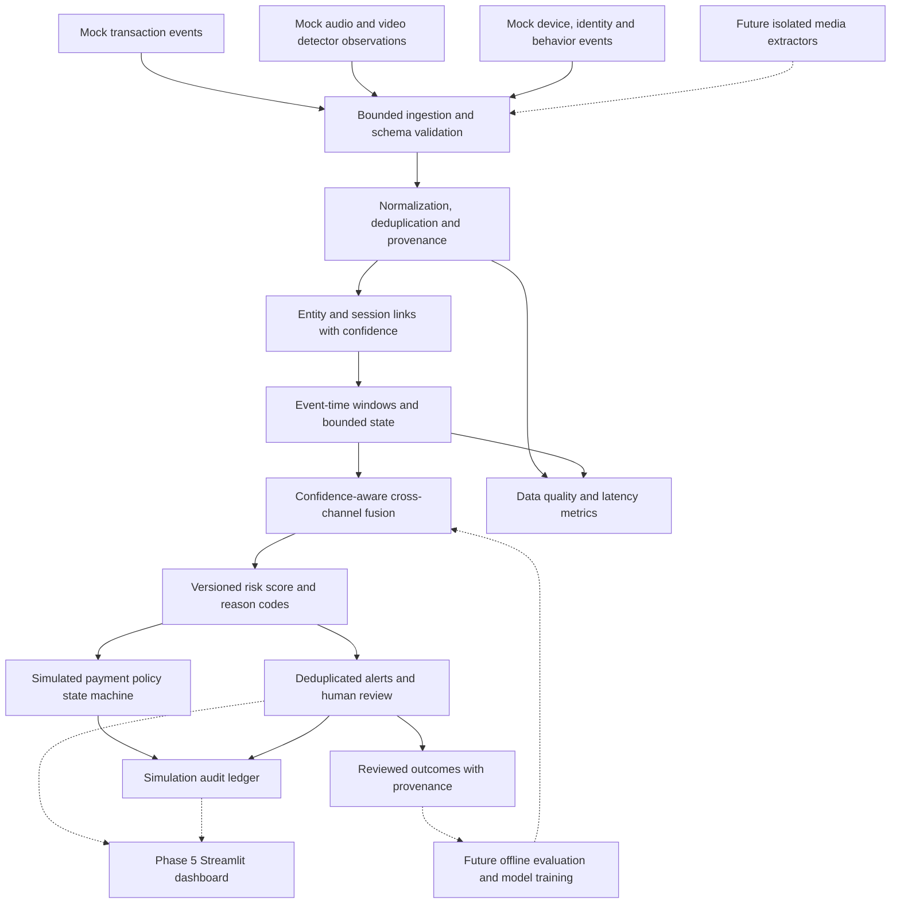

# FraudGuard AI — proposed architecture

Status: research/design proposal, 2026-10-18. This document specifies future work;
no component described here was implemented, installed or benchmarked in this
phase. The repository's existing transaction-rule starter remains unchanged.
Evidence IDs refer to [REFERENCES.md](REFERENCES.md); thresholds, windows and
policy choices below are proposals, not published findings or measured results.

## Purpose and boundaries

Build an original cross-channel correlation engine for suspicious financial
activity. Correlate transaction, audio, video, device, identity and behavioral
signals within a tenant and an explicitly linked session/account. Media anomaly,
authentication confidence and financial fraud are different concepts: a synthetic
voice alone does not establish a fraudulent payment, and authentic media does not
establish a legitimate transaction.

The MVP demonstrates fusion and simulated policy with synthetic telemetry and
precomputed/mock detector observations. It does not promise trained deepfake
detection, real-time media inference, production banking integration or live
payment blocking. Actual media extraction models and learned fusion are future
extensions subject to data and LinuxONE verification. CPU execution is the
baseline; GPUs, x86 acceleration and IBM-specific accelerators are not assumed.

## Components and data flow

Solid arrows describe planned MVP data flow across phases 2–4; dashed arrows
are later integrations, not current functionality. Every mock or derived record
must carry a `simulated` flag. The dashboard in phase 5 reads the same stable
contracts; it must not contain the scoring engine. A bounded in-process queue
and standard-library storage interfaces are sufficient initially. Kafka/Flink
and distributed feature stores are future scale options (R11), not MVP services.

## Event contracts and normalization

Use a versioned envelope with the following conceptual fields. Names are proposed
contracts, not an implemented schema:

| Field group | Required meaning |
| --- | --- |
| Identity | `schema_version`, unique `event_id`, `tenant_id`, `source_id`, channel and event type |
| Linkage | Tenant-scoped pseudonymous account/subject/device/session IDs, optional transaction/correlation ID, linkage method and confidence |
| Time | UTC `event_time`, `ingest_time`, optional observation start/end, sequence number, timestamp uncertainty/clock offset estimate |
| Provenance | Producer identity, detector/model/config version, source observation ID, integrity status, simulated flag |
| Observation | Named features with units, validity ranges, raw score semantics/direction, calibration version, quality and missingness status |
| Governance | Purpose/consent reference when applicable, retention class, sensitivity class, trace/audit ID |

Normalize money to integer minor units plus ISO currency and currency precision;
never compare currencies without a timestamped, versioned conversion policy.
Normalize durations and offsets to explicit milliseconds, rates to stated time
windows, detector scores to documented directions and ranges. Preserve original
units and transformation versions. Reject non-finite/out-of-range scores and
oversized payloads. Invalid or unauthenticated events go to a bounded quarantine
with redacted reason codes, not silently into the score.

Separate `unavailable`, `not_observed`, `low_quality`, `failed`, `stale` and
`valid` from a numeric low-risk result. Store only needed features and protected
references to media, not raw recordings in event envelopes. Prefer authenticated
session/transaction links. Never join across tenants; never merge identities
based on a shared IP address, approximate name or biometric resemblance alone.
Ambiguous links remain uncorrelated and visible as uncertainty.

## Feature adapters and candidate research methods

Each future adapter returns an observation with evidence span, detector version,
score semantics, uncertainty, quality and failure state. The MVP consumes mock
observations through these interfaces; real adapters are optional future work.

| Channel | Candidate features/methods | Limitations and evidence |
| --- | --- | --- |
| Transaction | Amount deviation from prior customer history, velocity, new beneficiary, merchant/location change; robust median/MAD or isolation-style anomaly model; supervised logistic/tree classifier when reliable labels exist | Historical baselines must use only prior events. Unusual does not mean fraudulent. Validate imbalance, delayed labels and drift (R9); sequence models are future work (R10). |
| Audio spectral | LFCC/CQCC, spectral shape, phase/frequency irregularities with a simple classifier | Resampling, codec and noise can create confounds; distinguish LA synthesis/conversion from PA replay (R1–R2). |
| Audio prosodic | Pitch/energy contours, pause/rhythm/duration and voice-quality measures where signal quality permits | Experimental hypothesis, not deception detection. Language, stress, disability and recording quality may dominate. R5 provides tooling concepts, not fraud-validation evidence. |
| Audio learned | Waveform encoder, AASIST-style spectral/temporal representation, wav2vec-style pretrained embeddings | Future comparison; GPU-era dependencies are not approved for this CPU/s390x project. Hold out generators and speakers (R3–R4). |
| Replay/anti-spoof | Channel/reverberation cues and replay-specific classifier; optionally randomized liveness challenge with consent | Playback devices, rooms and microphones require separate validation (R2). No guarantee against adaptive attacks. Keep speaker verification separate from spoof detection. |
| Video spatial | Face-region blending, texture/frequency and geometry inconsistencies | Compression and illumination can mimic manipulation. Source-video splits and unseen methods required (R6). |
| Video temporal | Mouth-motion/landmark consistency, frame-to-frame identity/texture stability | Occlusion, dropped frames and tracking errors must lower quality, not automatically raise fraud certainty (R7). |
| Audiovisual | Lip/audio offset and matching confidence over timestamped segments | Requires both channels and a speaking face; dubbing or jitter can explain mismatch and synchronized fakes can pass (R8). |
| Device/identity | New device, integrity/attestation status where supported, authentication resets, session binding, failed step-up checks | Source reliability matters; shared devices, travel and accessibility needs are benign alternatives. Biometric identity confidence is not intent. |
| Behavior | Changes in interaction cadence, session navigation and transaction sequences relative to prior baseline | Explicit purpose and consent/legal review; sparse histories mean unknown. Avoid invasive fingerprinting and demographic proxies. |

## Time alignment and bounded correlation

Preserve event time separately from processing time (R11). For mock streams,
start with a configurable two-minute lookback for session/transaction evidence,
five-minute velocity aggregates and a ten-second allowed-lateness budget. These
are scenario parameters to tune, not guarantees or validated operating values.
Media spans use observation intervals; ingestion time must not replace capture
time. Track clock uncertainty and source quality. When uncertainty exceeds a
join tolerance, abstain from a time-sensitive match and emit a quality warning.

Partition state by tenant and linked entity/session. Deduplicate by source and
event ID, and carry detector lineage to avoid counting a retried observation or
two scores from the same recording as independent evidence. Join within windows
using trustworthy IDs plus temporal proximity. A correlation example is a
new-device identity reset, followed by a suspicious call observation and a new
beneficiary transfer in the same authenticated session. Mere co-occurrence is
not causal proof. A shared household IP must not create this relationship.

A watermark records tolerated event-time progress. Define idle-source timeouts,
bounded queue/state sizes, expiry and backpressure; quarantine implausible future
timestamps so an attacker cannot advance progress. Late evidence within the
retained revision horizon creates a new score revision and an audit trail. Beyond
that horizon it becomes a late-evidence record for review rather than silently
changing a completed decision. Do not assume exactly-once delivery: make
processing and simulated interventions idempotent with stable decision IDs.

## Confidence, fusion and risk scoring

Keep four quantities distinct: anomaly/fraud evidence strength, detector
reliability, input quality, and entity-link confidence. A detector output of 0.9
is not necessarily a 90% fraud probability. Calibrate with labeled held-out data
before using probability language; keep simulated calibration visibly labeled.

Proposed interpretable heuristic for phase 4:

`z = b + sum(w_i * e_i * q_i * l_i * d_i) + sum(v_j * c_j)`

`risk_index = round(100 / (1 + exp(-z)))`

Here `e_i` is validated evidence strength in [0,1], `q_i` is quality/reliability,
`l_i` is link confidence, `d_i` is time decay in [0,1], and `c_j` is an explicit
cross-channel pattern. Weights, decay, bias and thresholds are versioned
scenario settings. The sigmoid is a bounded index, **not a probability** without
calibration. Group correlated detectors and cap their combined contribution;
interaction terms must replace or limit overlapping evidence, not double count
it. Missing evidence contributes no evidence and separately reduces coverage;
it must not be represented as proof of low risk. Negative evidence or alternate
calibrated models require an explicit later design revision.

Return score/index, coverage, uncertainty/abstention status, contributing event
IDs, time window, per-channel/group contributions, rule IDs and versions. High
uncertainty or poor linkage routes to review rather than unconditional simulated
blocking. H1: this late-fusion design improves recall at a fixed review budget;
H2: reliability weighting reduces false positives. Both are untested hypotheses
(R12). Do not train a learned fusion model on unrelated dataset pairs presented
as real aligned fraud examples.

## Explainability, alerts and simulated intervention

An alert contains a pseudonymous entity/session, relevant transaction, score
revision, uncertainty, coverage, top reason codes, evidence timeline, benign
alternatives and recommended review action. Reasons must trace to actual
observations; do not describe model attribution as causality (R14). Deduplicate
alerts by case/transaction and revision policy, apply cooldowns, and preserve
new material evidence without flooding reviewers.

The phase 4 payment simulator has proposed states `observed`, `allow_simulated`,
`step_up_simulated`, `hold_simulated`, `release_simulated` and `deny_simulated`.
Use configurable risk bands and evidence/coverage requirements, not hard-coded
claims of safe banking thresholds. An ambiguous case can request review even at
a low risk index. Holds have a bounded expiry and explicit escalation/timeout
outcome; unavailable reviewers must not leave an indefinite simulated hold.
Record old/new state, reason, actor, policy version and idempotency key. Late
evidence may revise a recommendation but must not replay an irreversible action.
No network route to real payment endpoints, credentials or money movement exists
in the MVP. Display “simulation” on every intervention and later dashboard view.

Reviewers can release/override a simulated decision and record rationale and
label confidence. Support correction/appeal and disagreement review. An override
is not automatically ground truth. Future training must use reviewed provenance,
label maturity and monitoring for selection bias and feedback poisoning.

## False positives, privacy and security

- Evaluate channel-only baselines against fusion at a fixed false-positive and
  review budget. Include benign travel, shared devices, poor connectivity,
  accessibility aids, dubbing, synthetic speech used legitimately, missing
  modalities and new customers. Abstain when evidence is insufficient.
- Use temporal holdouts and label-delay gaps (R9); separate related speakers,
  source videos and sessions between train/test. Measure PR-AUC/average precision,
  recall at an agreed false-positive budget, alert precision, review load,
  calibration/Brier score for probabilistic models, subgroup outcomes and drift.
  Benchmark EER/t-DCF (R2) supplements, not replaces, financial metrics.
- Default to synthetic data. Before real data, document purpose and consent or
  other lawful basis, residency, access, subject rights and legal/security
  review. Keep raw media disabled by default; do not store payment card numbers,
  identity documents or sensitive transcripts in telemetry or logs.
- Proposed simulation retention: raw media zero retention, correlation state
  fifteen minutes, pseudonymous feature events seven days and redacted decision
  audits thirty days. These are configurable design defaults, not legal advice
  or approved production policy. Keep revision horizon within retained state.
  Propagate expiry/deletion to derived stores, exports and backups under a
  documented schedule; audit restricted legal-hold exceptions if later needed.
- Encrypt transit/storage, restrict roles and tenants, use managed secret storage
  and keyed tenant-scoped pseudonyms, and audit sensitive access. Embeddings
  remain potentially identifying. Minimize reviewer access to raw evidence.
- Authenticate producers, check replay IDs, validate schemas and provenance,
  rate-limit input and isolate future untrusted media decoders. Protect model
  artifacts with provenance/hashes and approved serialization; never load
  untrusted executable model files. Test tenant leakage and malicious payloads.

## Python 3.12 and LinuxONE compatibility gate

Prefer Python 3.12 standard-library facilities for envelope types, decimal/money
policy, UTC timestamps, JSON, bounded queues and deterministic replay. They avoid
new third-party native dependencies, but Python itself and SQLite/SSL integrations
still require a supported target runtime. Optional NetworkX has a universal wheel;
NumPy/SciPy/scikit-learn/pandas/ML runtimes have native requirements. See R15's
version-specific metadata table. SoundFile and Streamlit illustrate why universal
Python wheels do not prove the whole stack is pure Python.

Before adoption in the relevant phase, on actual LinuxONE s390x:

1. Record OS, `uname -m`, Python 3.12 patch level, glibc, compiler and installed
   shared-library versions. This research host is not a substitute for that target.
2. Resolve the complete selected dependency graph, inspect Python/ABI/platform
   tags (including compatible `abi3` tags) and distribution constraints, and check
   trusted vendor channels. A missing public wheel does not prove impossibility.
3. If no compatible verified wheel exists, assess a reproducible native build:
   C/C++/Fortran/Rust toolchains as needed, BLAS/LAPACK, OpenMP, libsndfile, media
   codecs and Arrow libraries. Inspect endianness, CPU instruction assumptions,
   model operators and memory use. Do not silently substitute x86 wheels or
   disable checks. A documented old s390x stack is not Python 3.12 validation.
4. Build/pin with hashes and provenance, review licenses/advisories, run import
   and representative numerical/media inference checks, then project tests on
   CPU. Verify serialization and output tolerances across architectures.
5. Measure throughput, p50/p95/p99 decision latency, state memory, startup and
   overload behavior on target hardware. Select latency targets from measurements;
   no real-time SLA or accelerator performance is claimed here.

Streamlit remains phase 5; its transitive Arrow/numerical/image dependencies are
an early planning risk, not grounds to implement a replacement dashboard now.
No packages, lockfiles, builds or compatibility tests were added in phase 1.

## Delivery sequence and future acceptance criteria

| Phase | Required result before advancing | Deferred work |
| --- | --- | --- |
| 1. Research knowledge base | This bibliography, proposed contracts/design, evidence limits, risks and permanent instructions reviewed | All new application implementation |
| 2. Fraud fusion engine | Original envelope, validation, deterministic bounded correlation and mock-observation interface; tests for linkage, duplicates, clock uncertainty, missingness and tenant isolation | Media models and distributed brokers |
| 3. Mock real-time telemetry streams | Seeded transaction/audio/video/device/identity/behavior scenarios with delays, benign confounders and labeled simulated provenance; repeatable replay | Real customer collection |
| 4. Risk scoring and payment intervention simulation | Versioned index, exact reason contributions, uncertainty/review routing, idempotent state transitions, late revisions and retention tests | Live payment actions and production efficacy claims |
| 5. Streamlit dashboard | Simulation-labeled case timeline, score contributions, coverage, reviewer actions and access controls; scoring stays outside UI | New fusion models |
| 6. LinuxONE deployment and testing | Verified Python 3.12/s390x dependency set, CPU integration/load/security tests, reproducible build evidence and documented limits | Accelerator-specific optimization |

Compatibility research starts in phase 1, and checks continue when dependencies
are considered; the full deployment/testing milestone remains phase 6.
Future enhancements include real spectral/prosodic/learned media adapters,
replay/liveness evaluation, consented aligned datasets, calibrated supervised
fusion, graph/ring detection, drift monitoring and distributed ingestion. They
must demonstrate benefit over the interpretable baseline and pass the same
privacy, security and platform gates before adoption.
